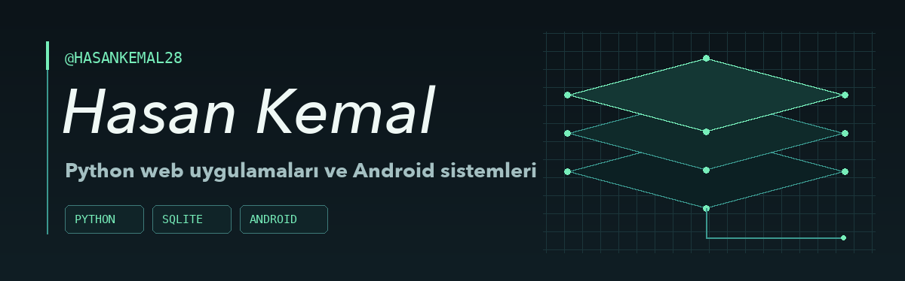

  

Python ve SQLite ile iş akışlarını web uygulamalarına dönüştürüyorum. Veri modeli, HTTP API ve tarayıcı arayüzü üzerinde çalışıyorum. Android tarafında cihaz ağaçları ve Linux tabanlı mobil sistemlerle ilgileniyorum.

## Geliştirme notları

| Alan | Teknik odak |
| --- | --- |
| Web paneli | Python HTTP API, JavaScript arayüz, SQLite ve şube kapsamına göre yetkilendirme. Personel, cari hesap ve kasa işlemleri aynı panelde. |
| e‑Fatura | UBL‑TR XML üretimi, XAdES imzası, XSD doğrulaması ve şube bazlı arşiv. Numara tahsisi ile arşiv kaydı aynı veritabanı işleminde. |
| Android ve mobil Linux | Huawei P20 Lite ve Samsung Galaxy S6 cihaz ağaçları, halium-devices ve postmarketOS kaynakları. |

## Açık depolar

| Proje | Kaynak |
| --- | --- |
| Huawei P20 Lite cihaz ağacı | [android_device_huawei_p20lite](https://github.com/hasankemal28/android_device_huawei_p20lite) |
| Galaxy S6 Android cihaz ağacı | [android_device_samsung_hero2lte](https://github.com/hasankemal28/android_device_samsung_hero2lte) |
| Galaxy S6 için postmarketOS | [PostmarketOS-for-Samsung-Galaxy-S6-G920F](https://github.com/hasankemal28/PostmarketOS-for-Samsung-Galaxy-S6-G920F) |
